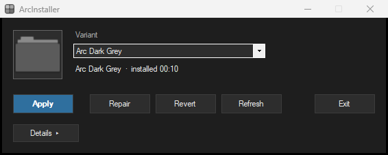
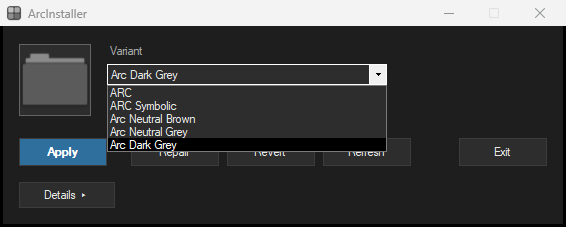
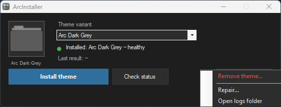
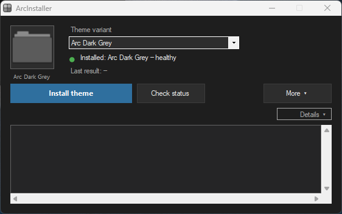

<p align="center">
  
</p>

<h1 align="center">ArcInstaller</h1>
<p align="center"><strong>Install, remove, and repair the ARC icon theme on Windows 10 and 11.</strong></p>

## Screenshots

All four captures come from the shipped `dist\ArcInstaller.exe`.



The main window as the shipped exe opens it.



All five theme variants in the picker.



The More ▾ overflow menu: *Remove theme…*, *Repair…*, and *Open logs folder*.



The details log strip showing a run's log.

## Install

Download `ArcInstaller.exe` from the [latest release](https://github.com/nathwn12/arc-installer/releases/latest), or build the one-file installer from source (that path needs network access at fetch time):

```powershell
git clone https://github.com/nathwn12/arc-installer.git
cd arc-installer
pwsh -NoProfile -File .\fetch-theme.ps1
powershell -NoProfile -ExecutionPolicy Bypass -File .\build.ps1
```

`fetch-theme.ps1` downloads the four upstream packs, verifies every archive against a pinned SHA-256, and derives Arc Dark Grey locally. `build.ps1` stages the payload and compiles `dist\ArcInstaller.exe`.

Install the theme in one command. The exe requires Administrator, so Windows asks once at launch:

```powershell
.\dist\ArcInstaller.exe --cli -Action install -Variant dark-grey -Yes
```

That single command checks the variant source, captures the pristine payloads if this is a fresh machine, merges the chosen variant, installs it, refreshes every logged-on profile's icon and thumbnail cache, and verifies the result. To change variant later, run the same command with another id from the table below; the switch re-merges, restores, and reinstalls in one action.

### Or use the window

Run `dist\ArcInstaller.exe` without `--cli`. The window has three actions:

- **Install theme** (primary): installs the selected variant. The dropdown preselects what is installed, and a variant switch confirms once before anything is written.
- **Check status**: read-only. Shows the installed variant, timestamp, payload hashes, and verification result; changes nothing.
- **More ▾**: *Remove theme…* puts the stock Windows payloads back, *Repair…* re-applies only when the live files match what this tool recorded and never overwrites an unknown payload, and *Open logs folder* opens `%ProgramData%\ArcIcons\logs`.

`Details ▸` expands the log strip. A failure turns the status line red, shows the first error in a red bar, and opens the details automatically, so a refusal is never silent or mistaken for success.

### Remove the theme

One command puts the stock Windows payloads back, refreshes every logged-on profile, and verifies the original state:

```powershell
.\dist\ArcInstaller.exe --cli -Action uninstall -Yes
```

Uninstall keeps `originals\` (the only pristine copy) and `logs\` so a reinstall stays safe. Add `-CleanState` to also remove `state.json`, `installed-manifest.json`, and `stage\`:

```powershell
.\dist\ArcInstaller.exe --cli -Action uninstall -CleanState -Yes
```

The exe is portable and keeps its working files under `%ProgramData%\ArcIcons`. After uninstall passes verification, remove that folder to delete the tooling, the pristine backup, and the logs:

```powershell
Remove-Item -Recurse -Force "$env:ProgramData\ArcIcons"
```

Keep the folder if you may want to install again without rebuilding; the pristine backup is what uninstall restores.

## Variants

| `-Variant` | Name | Source |
| --- | --- | --- |
| `arc` | ARC | niivu's upstream ARC pack |
| `arc-symbolic` | ARC Symbolic | niivu's upstream symbolic pack |
| `neutral-brown` | Arc Neutral Brown | niivu's upstream pack |
| `neutral-grey` | Arc Neutral Grey | niivu's upstream pack |
| `dark-grey` | Arc Dark Grey | derived locally from Arc Neutral Grey |

`dark-grey` is the tool default and a complete variant: all three payloads are recolored, one factor per icon group, with a group luminance floor of 64. The derivation and measured hashes are in [docs/arc-dark-grey-variant.md](docs/arc-dark-grey-variant.md).

## Command line

`--cli` runs the installed controller instead of opening the window. Without `--cli` the exe launches the window. Normal use is three commands: install, remove, and check status.

```powershell
.\dist\ArcInstaller.exe --cli -Action install -Variant dark-grey -Yes
.\dist\ArcInstaller.exe --cli -Action uninstall -Yes
.\dist\ArcInstaller.exe --cli -Action status
```

| Option | Effect |
| --- | --- |
| `-Action` | `install`, `uninstall`, or `status` for normal use; every verb is listed below |
| `-Variant` | Variant id or display name; default `dark-grey` |
| `-Yes` | Skip confirmations |
| `-DryRun` | Preview an install, uninstall, or repair without writing |
| `-CleanState` | With `uninstall`: also remove state and stage files; keeps `originals\` and `logs\` |

### Advanced commands

These are the CLI-only verbs. `install`, `uninstall`, and `status` are the
normal path shown above; the rest are for recovery and diagnostics, not normal
use. Each is documented in the [repair manual](docs/REPAIR-MANUAL.md).

| Action | What it does |
| --- | --- |
| `install` | Full install: source check, capture if fresh, merge and restore if switching, apply, per-user refresh, verify |
| `uninstall` | Full removal: restore the pristine originals, per-user refresh, verify original state |
| `status` | Same read-only check as Check status; prints hashes and exits non-zero on FAIL |
| `repair` | Re-apply only when the live payload matches the recorded original; never overwrites an unknown payload |
| `refresh` | Rebuild the shell icon cache for every logged-on profile |
| `merge` | Rebuild the staged payload from the originals and the theme |
| `apply` | Write the recorded merge to the live payloads without the controller |
| `revert` | Restore the pristine originals without the full uninstall orchestration |
| `task-on` | Enable auto-repair at startup |
| `task-off` | Disable auto-repair at startup |

Every verb runs through the same exe, for example:

```powershell
.\dist\ArcInstaller.exe --cli -Action status
.\dist\ArcInstaller.exe --cli -Action repair -DryRun
```

A first install cannot be previewed: it must capture the pristine payloads and merge, so `-DryRun` reports that and changes nothing.

## Requirements

- Windows 10 or 11, x64.
- Administrator rights. The exe manifest requires elevation; the scripts ask for it when run directly.
- Windows PowerShell 5.1, built into Windows, runs the installed scripts.
- PowerShell 7 for the fetch step shown above.
- The .NET Framework 4 C# compiler that ships with Windows, for the build.
- No network access after the build; the theme shapes are embedded in the exe.

## Recovery

1. Remove the theme first while the live payloads are still the ones this tool installed: `.\dist\ArcInstaller.exe --cli -Action uninstall -Yes`.
2. Check the result: `.\dist\ArcInstaller.exe --cli -Action status` prints PASS or FAIL with per-check detail.
3. If a Windows Update replaced the payloads, Repair deliberately writes nothing to the new files. The repair manual's re-merge procedure rebases the new originals, rebuilds, and applies.
4. If removal and status still fail, use the OS backstop: `sfc /scannow`, then `DISM /Online /Cleanup-Image /RestoreHealth`.

The full ladder and the measured file-replacement mechanism are in [docs/REPAIR-MANUAL.md](docs/REPAIR-MANUAL.md).

## Troubleshooting

- Icons look unchanged after install. Install and remove rebuild every logged-on profile's icon and thumbnail cache, then restart that profile's Explorer. A profile that is not signed in is not touched: sign that user in and run `-Action refresh`, or sign out and back in.
- Status is FAIL after install. Read the FAIL lines, then remove the theme. Every exit path restores and verifies the shell, so Explorer is not left stopped.
- `variant source ... is missing`. The chosen variant's payload is absent from the extracted theme tree; rebuild with `fetch-theme.ps1`, then run the new exe.
- `needs Administrator`. Accept the UAC prompt, or start from an elevated terminal.
- `sfc /scannow` flags a SystemResources file. That is expected after a resource edit; remove the theme before running a repair install.
- Explorer is not running. The scripts restore it before exit; if it is still absent, start it with `Start-Process explorer`.

Install layout and file roles: [docs/WHERE-IT-LIVES.md](docs/WHERE-IT-LIVES.md).

## Known limitations

- **Windows 10 needs all three payloads.** Install replaces
  `imageres.dll.mun`, `imagesp1.dll.mun` and `zipfldr.dll.mun`. A Windows 10
  build that does not ship `imagesp1.dll.mun` cannot install: capture stops
  with `imagesp1.dll.mun not found`. Windows 11 x64 English is the tested
  target; every other build is unverified.
- **English theme resources only.** The bundled packs carry English
  (language 1033) resources, and a theme icon missing from the stock payload is
  added as 1033 only. A non-English Windows may keep some stock glyphs.
- **A hard crash or power loss mid-apply can leave the `SystemResources`
  directory ACL granted to Administrators and a payload missing.**
  `%ProgramData%\ArcIcons\logs\apply.journal.jsonl` names the last operation in
  flight. `-Action repair` does not fix this: a missing or unknown live file is
  `drift-unknown-payload`, so it writes nothing. Recovery is uninstall, then
  reinstall: `.\dist\ArcInstaller.exe --cli -Action uninstall -Yes`, then
  `.\dist\ArcInstaller.exe --cli -Action install -Variant <id> -Yes`.
  `restore.ps1` recreates the missing payload and restores the directory
  baseline.
- **A Windows Update that replaces a payload blocks a reinstall until a rebase
  or re-merge.** `-Action install` and the window's Install theme both refuse
  with `live payload is neither the recorded original nor the recorded merge`,
  and `-Action repair` reports `drift-unknown-payload` without writing. Do not
  use `-Action revert` or `-Action uninstall` before that rebase: both go
  straight through `restore.ps1`, which puts the pre-update originals back and
  rolls the update back.
- **Uninstall leaves traces.** Restored payloads are new files copied from
  `originals\`, not the original WinSxS hardlinks, so the original file identity
  is not restored even when bytes and SDDL match. One directory control flag
  (`D:PAI`) cannot be reproduced byte-for-byte; the restore journals it as
  `exact=false`. `-Action uninstall` also does not remove the `ArcIcons-Repair`
  scheduled task (when auto-repair was enabled) or `%ProgramData%\ArcIcons`:
  run `install-autorepair.ps1 -Uninstall` and delete the folder by hand.
- **Multi-user refresh is proven by transport, not by two live profiles.**
  `tests\Test-UserRefreshTransport.ps1` proves the per-profile InteractiveToken
  transport and the worker's SID/session receipt with `-DryRun`; the actual
  cache drop in a second logged-on profile is not covered by a live test here.
- **No ARM64 build.** The installer and payload target x64 Windows only.

## Development

```powershell
powershell -NoProfile -ExecutionPolicy Bypass -File .\build.ps1
.\dist\ArcInstaller.exe --selftest
powershell -NoProfile -File .\verify.ps1
powershell -NoProfile -File .\tests\Test-VariantParity.ps1
```

`--selftest` unpacks the embedded payload and checks every extracted file against the embedded manifest; exit 0 means the payload is intact. It needs an elevated shell. `verify.ps1` is a read-only host check and needs the tool root with its recorded originals. `Test-VariantParity.ps1` pins the three variant tables to the same five ids.

## License

MIT. See [LICENSE](LICENSE).

## Links

- [Repair manual](docs/REPAIR-MANUAL.md)
- [Install map](docs/WHERE-IT-LIVES.md)
- [Arc Dark Grey derivation](docs/arc-dark-grey-variant.md)
- [MIT](LICENSE)

<!-- nathwn12 house footer: identical in every repo. Do not edit. -->
<p align="center">
  <a href="https://github.com/nathwn12"></a>
</p>
<p align="center">
  <sub>Built by <a href="https://github.com/nathwn12">nathwn12</a> · <a href="https://github.com/nathwn12?tab=repositories">All projects</a></sub>
</p>
