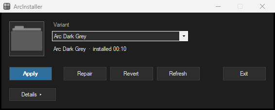

<p align="center">
  
</p>
<h1 align="center">ArcInstaller</h1>
<p align="center"><strong>Install, remove, and repair the ARC icon theme on Windows 10 and 11.</strong></p>

<p align="center">
  
</p>

<p align="center">
  
  
  <a href="LICENSE"></a>
</p>

## Why ArcInstaller

Installing the ARC icon theme on Windows means replacing protected files in the system resources directory. Doing that by hand is easy to get wrong, and a bad replace leaves the shell with broken icons.

- **One portable exe.** No package manager, no installer framework, no runtime to fetch.
- **Pinned payloads.** Four upstream packs are checked against SHA-256 before anything is merged.
- **Safe by default.** Install, remove and repair keep a pristine copy. Repair refuses an unknown payload instead of overwriting it.
- **Proof in the tool.** `--selftest` checks every extracted file against the embedded manifest, so a build is verified from its own bytes.

## Install

Download `ArcInstaller.exe` from the [latest release](https://github.com/nathwn12/arc-installer/releases/latest) and run it. One portable exe; its manifest requires Administrator, so Windows asks once at launch.

Install the theme in one command. It checks the variant source, captures the pristine payloads if this is a fresh machine, merges the chosen variant, installs it, refreshes every logged-on profile's icon and thumbnail cache, and verifies the result:

```powershell
.\ArcInstaller.exe --cli -Action install -Variant dark-grey -Yes
```

### Offline or pinned

Build the one-file installer from source. The fetch step needs network access once; after that the theme is embedded in the exe and an install needs none:

```powershell
git clone https://github.com/nathwn12/arc-installer.git
cd arc-installer
pwsh -NoProfile -File .\scripts\fetch-theme.ps1
powershell -NoProfile -ExecutionPolicy Bypass -File .\scripts\build.ps1
```

`fetch-theme.ps1` downloads the four upstream packs, verifies every archive against a pinned SHA-256, and derives Arc Dark Grey locally. `build.ps1` stages the payload and compiles `dist\ArcInstaller.exe` — the same commands with `dist\` in front. To pin an exact version, add `git checkout v0.2.2` before fetching.

## Use it

Run `ArcInstaller.exe` without `--cli` and the window opens:

- **Install theme** (primary) installs the selected variant. The dropdown preselects what is installed, and a variant switch confirms once before anything is written. To change variant later, run the install command with another id from the table below: the switch re-merges, restores, and reinstalls in one action.
- **Check status** is read-only: it shows the installed variant, timestamp, payload hashes and verification result, and changes nothing.
- **More ▾** holds *Remove theme…* (puts the stock Windows payloads back), *Repair…* (re-applies only when the live files match what this tool recorded, and never overwrites an unknown payload), and *Open logs folder*.
- `Details ▸` expands the log strip. A failure turns the status line red, shows the first error in a red bar, and opens the details automatically, so a refusal is never silent or mistaken for success.

Remove the theme with one command. It puts the stock Windows payloads back, refreshes every logged-on profile, and verifies the original state:

```powershell
.\ArcInstaller.exe --cli -Action uninstall -Yes
```

Uninstall keeps `originals\` (the only pristine copy) and `logs\` so a reinstall stays safe. Add `-CleanState` to also remove `state.json`, `installed-manifest.json`, and `stage\`. After verification passes, deleting `%ProgramData%\ArcIcons` removes the tooling, the pristine backup and the logs; keep the folder if you may install again without rebuilding.

If the icons look unchanged, the shell kept its old cache: a signed-out profile is not touched, so sign that user in and run `--cli -Action refresh`, or sign out and back in. [The repair manual](docs/REPAIR-MANUAL.md) carries the recovery ladder and the rest of the failure modes.

## Configure it

Variant ids for `-Variant`; `dark-grey` is the default:

| `-Variant` | Name | Source |
| --- | --- | --- |
| `arc` | ARC | niivu's upstream ARC pack |
| `arc-symbolic` | ARC Symbolic | niivu's upstream symbolic pack |
| `neutral-brown` | Arc Neutral Brown | niivu's upstream pack |
| `neutral-grey` | Arc Neutral Grey | niivu's upstream pack |
| `dark-grey` | Arc Dark Grey | derived locally from Arc Neutral Grey |

`dark-grey` is a complete variant: all three payloads are recolored, one factor per icon group, with a group luminance floor of 64. The derivation and the measured hashes are in [docs/arc-dark-grey-variant.md](docs/arc-dark-grey-variant.md).

| Option | Effect |
| --- | --- |
| `-Action` | `install`, `uninstall`, or `status` for normal use; every verb is listed below |
| `-Variant` | Variant id or display name; default `dark-grey` |
| `-Yes` | Skip confirmations |
| `-DryRun` | Preview an install, uninstall, or repair without writing |
| `-CleanState` | With `uninstall`: also remove state and stage files; keeps `originals\` and `logs\` |

One recipe — dry-run a variant switch, then apply it. On a first install `-DryRun` cannot preview: the capture and merge have to run, so it reports that and changes nothing.

```powershell
.\ArcInstaller.exe --cli -Action install -Variant arc-symbolic -DryRun
.\ArcInstaller.exe --cli -Action install -Variant arc-symbolic -Yes
```

Every verb runs through the same exe: `install`, `uninstall` and `status` are the normal path, while `repair`, `refresh`, `merge`, `apply`, `revert`, `task-on` and `task-off` are for recovery and diagnostics. Each is documented under [Commands](docs/REPAIR-MANUAL.md#commands) in the repair manual, along with the files the tool owns.

## Requirements

- Windows 10 or 11, x64.
- Administrator rights. The exe manifest requires elevation; the scripts ask for it when run directly.
- Windows PowerShell 5.1, built into Windows, runs the installed scripts; PowerShell 7 runs the fetch step shown above.
- The .NET Framework 4 C# compiler that ships with Windows, for the build.

### Known limits

- Windows 10 needs all three payloads. A Windows 10 build that ships no `imagesp1.dll.mun` cannot install: capture stops with `imagesp1.dll.mun not found`. Windows 11 x64 English is the tested target; every other build is unverified.
- English theme resources only: a theme icon missing from the stock payload is added as language 1033, so a non-English Windows may keep some stock glyphs.
- A Windows Update that replaces a payload blocks a reinstall until a rebase or re-merge, and `install` and `repair` refuse an unknown payload rather than overwriting it. Do not run `revert` or `uninstall` before that rebase: both put the pre-update originals back and roll the update back.
- A hard crash or power loss mid-apply can leave a payload missing and the `SystemResources` directory ACL granted to Administrators. `apply.journal.jsonl` names the last operation in flight, and recovery is uninstall, then install.
- Uninstall restores new files copied from `originals\`, not the original WinSxS hardlinks, and leaves the auto-repair scheduled task and `%ProgramData%\ArcIcons` behind.
- The multi-user refresh is proven by transport, not by two live profiles: `tests\Test-UserRefreshTransport.ps1` covers the transport and the receipt with `-DryRun`.
- No ARM64 build.

## Development

```powershell
powershell -NoProfile -ExecutionPolicy Bypass -File .\scripts\build.ps1
.\dist\ArcInstaller.exe --selftest
powershell -NoProfile -File .\scripts\verify.ps1
powershell -NoProfile -File .\tests\Test-VariantParity.ps1
```

`--selftest` unpacks the embedded payload and checks every extracted file against the embedded manifest; exit 0 means the payload is intact. It needs an elevated shell. `verify.ps1` is a read-only host check and needs the tool root with its recorded originals. `Test-VariantParity.ps1` pins the three variant tables to the same five ids.

## Status

**Unverified** — as-is, use at your own risk.

## Links

- [Issues](https://github.com/nathwn12/arc-installer/issues) — report a break with the action you ran and what it printed.
- [Releases](https://github.com/nathwn12/arc-installer/releases) — the portable `ArcInstaller.exe`.
- [Repair manual](docs/REPAIR-MANUAL.md) — measured mechanism, every command, the recovery ladder, the risk list.
- [Install map](docs/WHERE-IT-LIVES.md) — what lives under `%ProgramData%\ArcIcons`, and the files it changes.
- [Arc Dark Grey derivation](docs/arc-dark-grey-variant.md) — one factor per icon group and the measured hashes.
- [Upstream theme packs](https://github.com/niivu/resource-redirect-icon-themes) — niivu's ARC and Arc Neutral packs for Windhawk Resource Redirect.
- [MIT licence](LICENSE)

Built by nathwn12
